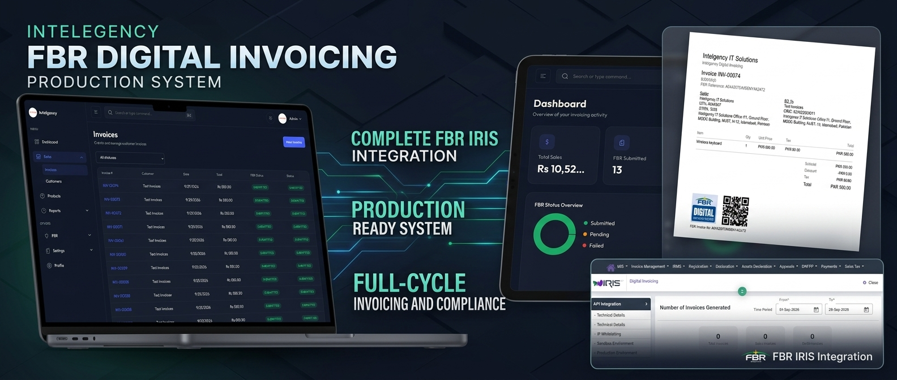

# FBR Digital Invoicing

A full-stack invoicing and tax compliance platform for businesses operating under the Pakistan FBR digital invoicing model. The project includes a React frontend, an Express + TypeScript backend, and a MongoDB-backed data layer designed for multi-tenant invoice workflows, role-based access control, PDF generation, and FBR submission tracking.

## Overview
    

This application is designed to help a business manage:

- company profile and configuration
- employees and admin users with RBAC
- products and catalog pricing
- customer records
- invoicing workflows and calculations
- FBR submission status tracking
- sales and tax reporting dashboards
- secure authentication and auditability

The repository is structured as a monorepo with separate frontend and backend apps.

## Features

- Authentication with JWT and password hashing
- Business role management (ADMIN, ACCOUNTANT, etc.)
- Multi-tenant data isolation by company
- CRUD for products, customers, invoices, and users
- Automatic invoice totals and calculations on the server
- PDF generation for printable invoices
- FBR submission workflow with status monitoring
- Dashboard and reporting views for revenue and tax metrics
- MongoDB-backed persistence with transaction-safe write patterns for financial data

## Tech Stack

### Frontend
- React 19
- TypeScript
- Vite
- Tailwind CSS
- React Router

### Backend
- Node.js
- Express 5
- TypeScript
- MongoDB with Mongoose
- JWT, Helmet, CORS, rate limiting
- PDFKit
- Zod for validation

## Project Structure

```text
fbr-digital-invoices/
├── backend/                  # Express API and business logic
│   ├── src/
│   ├── .env.example
│   ├── package.json
│   └── tsconfig.json
├── frontend/                 # React + Vite application
│   ├── src/
│   ├── package.json
│   └── vite.config.ts
├── docs/                     # API, architecture, planning, FBR integration docs
├── README.md
├── uoms.json
└── .gitignore